# Enterprise Knowledge Engine

> **A knowledge engine that reads a company's documents in any common format, keeps a dated record of every rule and which source says it, and answers questions with cited, verified answers, including what the rule was on a given date.**

[](https://www.python.org/)
[](https://fastapi.tiangolo.com/)
[](https://nextjs.org/)
[](https://github.com/pgvector/pgvector)

**Live demo:** https://ps07-knowledge-engine.vercel.app. The web app is hosted on Vercel, and the API and worker are served from the team's machine (see [Public demo](#public-demo)). When the API is not running, the site loads but cannot answer.

---

## The problem

Rules, tolerances and habits are spread across SOPs, spreadsheets, client memos, FAQs, email threads and recorded training sessions. Old versions stay in circulation, a stale FAQ can contradict the current SOP, and people answer each other's questions from memory over chat. The test case is **Meridian Shared Services**, a synthetic accounts-payable team. Its corpus has two SOP versions, desk instructions, client memos, an outdated FAQ, training-video transcripts and expert interviews.

The engine turns those documents into one dated record of rules and facts. It decides which source has authority, refuses to present an outdated rule as current, and sends questions the documents don't cover to the person who owns the topic.

---

## Four core ideas

### 1. Every fact has two dates (bitemporal)
Facts are never overwritten or deleted. Instead, they are closed off.
- **Valid time (`valid_from`, `valid_to`):** when the rule applied in the business. *"What was the price tolerance on 1 March 2026?"*
- **Transaction time (`recorded_at`, `retracted_at`):** when the engine learned or withdrew it. *"What would the engine have answered on 10 November?"*

You can pick a date in the composer, or write it in the question ("as of 1 March 2026"). The router reads a date written in the question, but ignores the dates of invoices or other events described in the case.

### 2. The best source wins, not the newest
Every source has a rank (by document type, version, status and client scope). For example, an FAQ uploaded today never outranks the SOP in force. A client memo overrides the general rule for that client only. A conflict scan finds statements that disagree, and opens owner-review items instead of silently picking one.

### 3. Any format, one block list
A parser cascade turns each file into one canonical block list (headings, paragraphs, table rows, speaker turns). Metadata (version, owner, effective date, status, client) is inferred from the document itself.

| Tier | What it handles | Status |
|---|---|---|
| 1 | Native parsers: DOCX, XLSX/CSV, PPTX, PDF text layer (including "a \| b" text tables), HTML, Markdown/plain text, EML (with attachments), VTT/SRT transcripts, JSON | Working |
| 2 | Legacy formats (DOC, PPT, XLS, ODF, RTF) converted with LibreOffice, then parsed by tier 1 | Working when LibreOffice is installed; otherwise the file is stored and flagged |
| 3 | Scanned PDFs and images: pages rendered and read by a vision model | Only when `MODEL_VISION` is set |
| 4 | Audio and video speech-to-text | **Not built yet.** These files are detected, stored and flagged (tier 5) |
| 5 | Anything unparseable: stored as-is and flagged for a person to review | Working |

Each parse gets a quality score, and a low score escalates the file to the next tier or holds it.

### 4. Verified before it is shown, escalated when not covered
A draft answer passes four checks before anyone sees it (`app/answer/verify.py`):
1. Every cited passage was retrieved, and the quoted text really occurs in it.
2. Every number appears in a cited passage, the calculator output or the question. The model never does arithmetic.
3. No value that is not in force on the day asked (superseded, overridden or not yet valid) appears for the topics the answer is about. This check is deterministic and uses the facts table.
4. A fast-model support check confirms that each sentence is backed by its cited evidence. It sees whether each source is in force.

If a check fails, the answer is regenerated with feedback. If the evidence is too weak, the user gets a **"The documents don't cover this"** card with a button that sends the question to the owning role (for example HR / Admin or the tax lead). The expert's reply reaches the asker straight away, labelled as not yet part of the knowledge base. It becomes a fact only after the process owner approves it. Approval re-asks the open question and notifies the asker.

---

## How an answer is produced

```mermaid
flowchart TD
    subgraph Ingestion ["Ingestion and graph building (background worker)"]
        A["Upload / folder watch / email (.eml)"] --> B["Intake: SHA-256 dedupe, format detection"]
        B --> C["Parser cascade (tiers 1-5)"]
        C --> D["Metadata inference + passage segmentation + PII redaction"]
        D --> E["Fact extraction, entity resolution, schema induction"]
        E --> F["Authority ranking, governance, conflict scan"]
        F --> G[("Postgres: sources, passages, facts, entities\n(time ranges + pgvector embeddings)")]
    end

    subgraph Query ["Answering a question"]
        Q["Question + optional date + client"] --> R["Router (lookup / calculation / practice / not covered)"]
        Q -.->|"in parallel"| S["Passage search: Postgres full-text + pgvector\n(only sources in force on the date, in the client's scope)"]
        S --> U["Reciprocal rank fusion -> cross-encoder rerank, keep 6"]
        U --> GC["Graph context: entities linked to the question + one hop, facts on the kept passages"]
        R -->|"rule values"| L["Direct rule lookup (get_rule: topic, parameter, client, date)"]
        R -->|"calculations"| T["Plug-in calculators (thresholds read from facts)"]
        GC --> V["Grounded generation (evidence only)"]
        L --> V
        T --> V
        V --> W{"4 checks"}
        W -->|"pass"| X["Cited answer card (rule in force, older versions, expert tips)"]
        W -->|"fail / weak evidence"| Y["Not-covered card -> send to owner"]
    end
```



Retrieval, precisely:
- **Keyword search** is Postgres full-text search, not BM25. A weighted `tsv` column with a GIN index is queried with an OR of the question's terms and ranked with `ts_rank_cd` (`app/store/search.py`).
- **Vector search** uses pgvector over embeddings of passages, facts and entities (fastembed BGE-small, built by the `index_embeddings` job).
- Both searches only see passages that were in force on the date asked: the source is live, not stale or draft, valid on that day, and either general or in the asker's client scope. This is where the bitemporal design comes in.
- The two lists are merged with **reciprocal rank fusion** (k = 60), then reranked by **`BAAI/bge-reranker-base`** (cross-encoder, CPU), and the top 6 are kept.
- **Graph context is a one-hop expansion, not a multi-hop walk.** The engine finds the entities linked to the question (by alias and embedding) and goes one hop along their object entities. It then adds the facts in force for those entities and the facts extracted from the kept passages.
- **Rule values come from a direct lookup, not a search.** `get_rule` (`app/graph/rules.py`) reads the facts table by topic, parameter, client and date (`valid_on`, `known_at`). It can't return an expired rule, and it raises an error instead of guessing.
- Passage search starts while the router is still deciding, to save a few seconds (`EARLY_RETRIEVAL`).
- The "graph" is ordinary Postgres tables (facts, entities and links, all with time ranges). There is no separate graph database.

---

## Two layers: generic core and domain plug-ins

1. **Generic core (`app/`):** no company or domain terms anywhere (enforced by `tests/test_core_is_generic.py`). It contains:
   - storage behind one repository layer (`app/store/`);
   - bitemporal facts;
   - schema induction and evolution (`app/graph/induce.py`, `evolve.py`);
   - entity resolution;
   - the conflict scan;
   - retrieval, generation and verification;
   - the job worker (`app/worker.py`, `FOR UPDATE SKIP LOCKED`).

   The core never imports `plugins/`.
2. **Accounts-payable plug-in (`plugins/ap/`):**
   - six deterministic calculators: price tolerance, quantity tolerance, TDS, approval limits, MSME payment dates and e-invoice threshold;
   - role and owner mappings, client bindings, and loaders for the operations workbook (vendors and invoices).

   Every threshold a calculator uses is read from the facts, so none are hard-coded.
3. **Schema modes:** `SCHEMA_MODE=induced` learns the topics and parameters from the documents. `SCHEMA_MODE=baseline` uses the hand-written reference schema (`plugins/ap/baseline_schema/`) for comparison.

---

## Tech stack

| Layer | Technology | Purpose |
|---|---|---|
| API | Python 3.11, FastAPI, Pydantic v2, SQLAlchemy 2, Alembic | Typed endpoints and OpenAPI docs. The tenant is chosen with `X-Tenant`, and every response carries `X-KB-Version` |
| Database | PostgreSQL 16 with `pgvector`, `pg_trgm`, `btree_gist` | Facts and entities with time ranges, full-text and vector search, fuzzy alias matching, job queue |
| Search | fastembed (BGE-small embeddings), `BAAI/bge-reranker-base` | Full-text + vector, RRF, cross-encoder rerank |
| LLM gateway | `app/core/llm.py` | One gateway for every call, with PII redaction (PAN, IFSC, bank accounts, phones, emails), an on-disk cache, a JSONL call log with cost, retries and rate limits |
| LLM providers | Any OpenAI-compatible endpoint (NVIDIA NIM, Isoquant), or Anthropic Claude | The public demo runs on Isoquant `deepseek-v4.1-flash-1017-fast` with zero data retention requested |
| Web | Next.js 14 (App Router), TypeScript, Tailwind CSS | Ask, Sources, Conflicts, Review, Entities, Changes, Analytics and Setup pages; citation drawer; timeline |
| Hosting | Vercel (web), Neon (Postgres), Cloudflare quick tunnel (API) | Public demo |
| Tests | pytest, ruff, Playwright | Default pytest suite; live-LLM and acceptance tests are opt-in |

---

## Repository layout

```
.
├── app/                    # Generic core engine
│   ├── answer/             # Router, retrieval, generation, verification, answer cards, escalation
│   ├── api/                # FastAPI routes (/ask, /ask/jobs, /episodes, /conflicts, /review, ...)
│   ├── core/               # Config, DB, LLM gateway, OpenAI-compatible client, redaction, reranker
│   ├── govern/             # Governance: what is applied automatically vs held for owner review
│   ├── graph/              # Extraction, entity resolution, rules, authority, conflicts, schema induction/evolution
│   ├── plugins/            # Plug-in loader and calculator registry (loads plugins/ by config, never imports them)
│   ├── ingest/             # Connectors, format detection, parser cascade, segmentation, metadata
│   ├── store/              # The only DB access layer: facts, entities, passages, search, jobs
│   └── worker.py           # Background job worker
├── plugins/ap/             # Accounts-payable plug-in: calculators, roles, bindings, baseline schema, loaders
├── web/                    # Next.js app
├── evaluation/             # Evaluation harness and metrics (configs A-D, judge, outdated-answer checks)
├── scripts/                # run_app, serve_public, dev_db, ingest_all, build_graph, run_eval,
│                           # run_replay, run_second_corpus, run_format_invariance, run_intake,
│                           # conflict_report, delete_episodes
├── tests/                  # unit, integration (Postgres), plugins, acceptance (live), leakage, generic-core guard
├── reports/                # Every measured result quoted below
├── migrations/             # Alembic
├── run.ps1 / run.cmd       # Local one-command start
└── run_public.ps1          # Public demo start (API + worker + tunnel, Vercel redeploy)
```

---

## Quick start (local)

Run these commands from the repository root (the directory containing this README). The launcher starts services, but it does not install dependencies, migrate the database, or load the sample corpus.

### First-time setup on Windows

Prerequisites: [uv](https://docs.astral.sh/uv/), Node.js 20+, and internet access for package installation and the first local model downloads. The commands below install Python 3.11 in this project; Python 3.14 has not been validated with this dependency set. The embedded Postgres instance needs no Docker.

```powershell
uv python install 3.11
uv venv --python 3.11 .venv
uv pip install --python .venv\Scripts\python.exe -e ".[dev]"
npm --prefix web ci
Copy-Item .env.example .env
Copy-Item web\.env.example web\.env.local
# Edit .env later and put your OpenAI key in OPENAI_API_KEY.
# In web\.env.local, set NEXT_PUBLIC_API_BASE_URL=http://localhost:8000.
.\.venv\Scripts\python.exe scripts\dev_db.py start
.\.venv\Scripts\python.exe -m alembic upgrade head
```

Keep the key in `.env`; both it and `web/.env.local` are git-ignored. The sample config selects `LLM_PROVIDER=openai`, `MODEL_SMART=gpt-4.1`, and `MODEL_FAST=gpt-4o-mini`. The schema-induction step can request up to 32,768 output tokens, so the smart model needs that capacity; `gpt-4o` is limited to 16,384 and fails here. You can change model IDs to other chat-completions models that support JSON mode and the required output limit. `MODEL_VISION` can be set separately for scanned PDFs. The `NIM_*` rate and timeout settings also govern OpenAI requests through the shared transport. The code does not have OpenAI pricing entries, so OpenAI calls record tokens but `cost_usd` is null.

After adding the key, load the sample knowledge base once:

```powershell
.\.venv\Scripts\python.exe scripts\ingest_all.py
.\.venv\Scripts\python.exe scripts\build_graph.py --auto-freeze
```

These steps make paid model calls. Graph building may take a while and downloads local embedding and reranker models on first use. Wait for both commands to finish before trying a live question.

If the `BAAI/bge-reranker-base` download cannot complete, set `RERANK_MODEL=none` in `.env` to use vector ranking. This bypass keeps the app usable but can select an older source; treat its answer accuracy as a separate, degraded configuration. Remove the setting to retry the normal reranker path.

### Start the app

```powershell
.\run.cmd
```

After first-time setup and corpus loading, this command:
- starts an embedded Postgres 16 with pgvector (no Docker needed; `scripts/dev_db.py`);
- starts the API on http://localhost:8000 (docs at `/docs`), the job worker, and the web app on http://localhost:3000;
- streams logs tagged `[api]`, `[worker]` and `[web]`, and opens the browser.

Ctrl+C stops everything and frees the ports. Optional flags are `--no-browser` and `--no-worker`. You can also run `run.ps1` if PowerShell permits local scripts; `run.cmd` works when script signing is enforced. On other platforms, use `python scripts/run_app.py`.

Main `.env` settings:
- `LLM_PROVIDER`: `openai`, `nim` (another OpenAI-compatible endpoint), or `anthropic`.
- `OPENAI_API_KEY`: used with `LLM_PROVIDER=openai`; never put it in the web environment file.
- `NIM_BASE_URL`, `MODEL_SMART`, `MODEL_FAST`: endpoint and models for `nim`. The `nim` transport reads `ISOQUANT_API_KEY` for Isoquant and `NVIDIA_API_KEY` for other compatible endpoints.
- `ANTHROPIC_API_KEY`: when `LLM_PROVIDER=anthropic`.
- `SCHEMA_MODE`: `induced` or `baseline`.
- `DATABASE_URL`: leave empty for the embedded database.

Secrets live only in `.env`, which is git-ignored. `web/.env.local` needs `NEXT_PUBLIC_API_BASE_URL=http://localhost:8000` to call the live API; an empty value shows fixtures instead.

### Running services one at a time
```bash
python scripts/dev_db.py start && python -m alembic upgrade head
python scripts/ingest_all.py
python scripts/build_graph.py --auto-freeze
python -m uvicorn app.api.main:app --port 8000
python -m app.worker
cd web && npm run dev
```

---

## Public demo

```powershell
.\run_public.ps1
```

This command starts the API and worker against the Neon database and opens a Cloudflare quick tunnel. If the tunnel address has changed, it rebuilds the Vercel site with the new address (about a minute). It reads `NEON_DATABASE_URL` and `VERCEL_TOKEN` from `.env`, and Ctrl+C stops everything.

A quick tunnel closes any request after about 100 seconds. For this reason, the web app starts an answer with `POST /ask/jobs` and polls `GET /ask/jobs/{id}`, and `POST /ask` remains for direct callers.

---

## Testing

Run the offline checks before spending tokens, then run the live checks after the key is present and the corpus is loaded. The default pytest selection excludes `live_llm` tests. Database integration tests still need the embedded database running and migrated.

```bash
python -m pytest -q             # offline default suite, including DB integration tests
python -m ruff check app scripts tests plugins
cd web && npm run lint && npm run typecheck && npm run check:tokens
python -m pytest -m live_llm    # after key + corpus setup; makes paid calls
cd web && npm run test:e2e      # with API, worker and web running
```

`tests/test_no_leakage.py` fails if application code reads the evaluation workbook. `tests/test_core_is_generic.py` fails if domain words appear in `app/`.

---

## Results

### Local OpenAI validation (13 November 2026)

The local OpenAI setup was ingested and evaluated on the 96-question development split. With `MODEL_SMART=gpt-4.1`, `MODEL_FAST=gpt-4o-mini`, and `RERANK_MODEL=none`, it reached **67/96 accuracy (69.8%)** and **86/96 strict citation accuracy (89.6%)**. The default suite passed **256 tests**. This is below the project's 90% answer-accuracy target. The configured reranker did not finish downloading, so these scores apply only to vector ranking. TDS rate bindings and an older-source selection are the main remaining correctness problems. See the [local validation report](reports/local_openai_validation_20261113.md) for configuration, checks, failures, and next gates.

The historical results below used different providers and configurations; they are not measurements of this OpenAI setup.

### Historical runs

Measured on 11 November 2026 unless stated. The source of each number is in `reports/`. The evaluation set has 160 questions: 96 dev and 64 holdout. Holdout failures are not inspected, apart from two that the team chose to examine.

| What | Result | Target | Report |
|---|---|---|---|
| Answer accuracy, all 160 questions (NVIDIA NIM, Neon) | **157/160 (98.1%)**: dev 96/96, holdout 61/64 (95.3%) | ≥ 90% | `eval_20261111_all.md`, `eval_20261111_rerun_Q011_Q054.md` |
| Citation accuracy | **98.1%** | ≥ 95% | same |
| Conflict questions presenting an old rule as current | **0/23** | 0 | same |
| Conflict questions that mention an old value while correcting it (strict metric) | 2/23 (Q021, Q062) | 0 | same |
| Acceptance tests T1–T11 on the public site (Isoquant) | **all pass**, 11–25 s per answer | all pass | `public_acceptance_20261111.md` |
| Conflict scan | **15/15** known conflicts found; authoritative source right in 14/15 | — | `conflicts_20261111.md` |
| Replay of the document history | **22/22** checks, idempotent | — | `replay_20261111.md` |
| Second, unrelated company (Kestrel Freight HR), no code changes | **10/10** cited answers | — | `second_corpus_20261111.md` |
| Intake of mixed incoming files | 11/12 handled as expected; a spoofed bank-change email held for review | — | `intake_20261111.md` |
| Metadata inferred vs the hand-made source index | 78/84 (92.9%) | ≥ 90% | `PROGRESS.md` |
| Same document in another format: fact F1 vs the original .docx | md 0.99, html 0.99, flat docx 0.92, pdf 0.88, eml 0.77; xlsx rerun pending after fixes | ≥ 0.90 | `format_invariance_20261111.md` |
| Latency | median 36 s on NIM with 2 parallel workers; 11–25 s end to end on Isoquant; retrieval alone 4.5–5.5 s on a laptop CPU | — | eval reports |
| Cost on Isoquant | about $0.0006 per question | — | LLM call log |

Notes on the two outdated-answer numbers:
- The metric counts any mention of a superseded value, even in a sentence like "the old 2% limit no longer applies".
- No answer presented an old rule as the rule in force.
- The answer prompt now allows an old value to be named only when the question itself quotes it.

### Known gaps
- **Not measured yet:**
  - entity-resolution F1;
  - learned vs hand-written schema comparison;
  - the 50-document freshness test;
  - paraphrase, abstention and adversarial question sets.
- **Formats:** the xlsx and eml format reruns are pending after today's parser fixes. Audio and video transcription (tier 4) is not built.
- **Extraction failures are not flagged:** an episode whose extraction fails on every passage is still marked published.
- **Latency:** answers take tens of seconds. Most of the time goes to model calls, and the reranker adds about 3 s on CPU.
- **Hosting:** the public demo depends on the API running on one machine through a quick tunnel.

---

## License

Proprietary. Built for the PS-07 case; Meridian Shared Services and Kestrel Freight are synthetic companies.
