# Enterprise Knowledge Engine

> **A temporal authority-graph knowledge engine that ingests company documents across any format, maintains an always-current bitemporal knowledge graph, and answers business queries with exact, verified citations.**

[](https://www.python.org/)
[](https://fastapi.tiangolo.com/)
[](https://nextjs.org/)
[](https://github.com/pgvector/pgvector)
[]()

---

## Overview & The Problem

Organizations keep rules, policies, tolerances, and operational habits scattered across SOPs, spreadsheets, slide decks, client memos, and email threads. As documents update, older versions remain in circulation. In our initial benchmark with **Meridian Shared Services** (an accounts-payable operations environment):
- **12.7%** of answers given over team chat were outdated.
- **33 minutes** was the median wait time for manual rule clarifications.
- Operators and processors repeatedly executed outdated procedures because no single system could definitively resolve which source held active authority.

**The Solution:** The Enterprise Knowledge Engine transforms heterogeneous business documents into an evolving, bitemporal knowledge graph. It separates a **domain-agnostic core engine** from **domain plug-ins**, guarantees source precedence over recency, verifies all claims closed-book, and routes unanswered queries directly to accountable process owners.

---

## 4 Core Architectural Innovations

```
                                  4 INNOVATION PILLARS
  ┌─────────────────────────┐  ┌─────────────────────────┐  ┌─────────────────────────┐  ┌─────────────────────────┐
  │      1. Two Clocks      │  │  2. Source Authority    │  │ 3. Universal Ingestion  │  │  4. Closed-Book Verifier│
  │  (Bitemporal Timeline)  │  │   (Best Source Wins)    │  │   (Zero-Setup Tiers)    │  │  & Expert Escalation    │
  ├─────────────────────────┤  ├─────────────────────────┤  ├─────────────────────────┤  ├─────────────────────────┤
  │ Valid Time:             │  │ Ranking by doc type,    │  │ 5 parser tiers convert  │  │ 4-point verification    │
  │   [valid_from, valid_to)│  │ version, status & scope.│  │ any format into one     │  │ blocks hallucinations;  │
  │ Transaction Time:       │  │ Stale FAQ ingested today│  │ canonical block list.   │  │ unverified questions    │
  │ [recorded_at, retracted)│  │ never beats current SOP.│  │ Learns schema on fly.   │  │ escalate to experts.    │
  └─────────────────────────┘  └─────────────────────────┘  └─────────────────────────┘  └─────────────────────────┘
```

### 1. Every Fact Has Two Clocks (Bitemporal Knowledge Graph)
Facts are never overwritten or deleted—they are closed off.
- **Valid Time (`valid_from`, `valid_to`):** When the fact was true in the real world. Answers: *"What was the price tolerance on 1 March 2026?"*
- **Transaction Time (`recorded_at`, `retracted_at`):** When our system learned or retracted the belief. Answers: *"What would the engine have told an auditor on 10 November 2026?"*

### 2. The Best Source Wins, Not the Newest
Standard RAG prioritizes recency or vector similarity, allowing newly uploaded old FAQs to overwrite authoritative SOPs. The engine resolves conflicts using **deterministic source hierarchy**:
- Authority hierarchy: Executive Policy > Standard Operating Procedure (SOP) > Client Addendum / Memo > Desk Instruction > Training Video / FAQ.
- Scope hierarchy: Specific client memos override general company rules **only** for that specific client scope.
- Conflicting statements trigger automated conflict scans and open owner-review tasks rather than silently guessing.

### 3. Universal Ingestion (Any Format, No Setup)
Five parser tiers normalize diverse documents into a single canonical block list (`heading`, `paragraph`, `table row`, `speaker turn`, `quote`, `figure`):
- **Tier 1:** Native parsers for DOCX, XLSX/CSV, PPTX, PDF text layer, HTML, Markdown, EML (with attachments), and VTT/SRT transcripts.
- **Tier 2:** Legacy format converters (DOC, PPT, XLS, RTF).
- **Tier 3:** Visual layout analysis via Vision LLMs for scans and image-heavy PDFs.
- **Tier 4:** Speech-to-text for audio and video.
- **Tier 5:** Unknown binaries stored and flagged for human review.
- **Proven generality:** Tested on an entirely unrelated corporate corpus (Kestrel Freight HR) with **10/10 questions answered accurately with citations with zero code changes**.

### 4. Closed-Book Verification & Expert Escalation
Before any answer is shown to a user, a separate **Verifier** enforces 4 strict invariants:
1. Every cited passage was actually retrieved and contains the exact quote.
2. Every number appears in a source passage or deterministic calculator output (no LLM arithmetic).
3. No superseded or expired value is presented as current.
4. Each generated sentence is directly supported by its citation.

If evidence is insufficient, the system returns a **"Not Covered"** card with a one-click button to route the question to the designated expert role (e.g. HR Admin, Tax Lead). The expert's response is presented immediately with a provisional label, and enters the graph as an official rule only after process owner review.

---

## System Architecture

```mermaid
flowchart TD
    subgraph Ingestion ["Ingestion & Graph Construction"]
        A["Document Drop / EML / API"] --> B["Intake & SHA256 Dedupe"]
        B --> C["5-Tier Parser Cascade"]
        C --> D["Structure & Metadata Inference"]
        D --> E["Passage Segmentation & Redaction"]
        E --> F["Entity Resolution & Schema Induction"]
        F --> G["Authority & Conflict Resolution"]
        G --> H[("Bitemporal Postgres Store\n(Entities, Facts, Vectors)")]
    end

    subgraph Query ["Query & Answer Pipeline"]
        Q["User Query + As-Of Date"] --> R["Query Router"]
        R -->|"Lookups"| S["Hybrid Search (BM25 + Vector + Graph Walk)"]
        R -->|"Calculations"| T["Plug-in Calculators (Dynamic Thresholds)"]
        S --> U["Reciprocal Rank Fusion (RRF) & BGE Reranker"]
        T --> V["Closed-Book Generation"]
        U --> V
        V --> W{"4-Point Verifier"}
        W -->|"Pass"| X["Cited Answer Card (Now vs Older)"]
        W -->|"Fail / Low Confidence"| Y["Not Covered Card -> Expert Escalation"]
    end
```



---

## Two-Layer Design: Core vs Plug-in

The codebase enforces a strict architectural boundary:
1. **Generic Core (`app/`):**
   - Contains zero domain or company-specific terminology (enforced by `tests/test_core_is_generic.py`).
   - Implements storage repository (`app/store/`), bitemporal facts, schema induction (`app/graph/induce.py`), continuous schema evolution (`app/graph/evolve.py`), conflict detection (`app/graph/conflicts.py`), hybrid retrieval, closed-book generation, and async background workers (`app/worker.py`).
2. **Domain Plug-ins (`plugins/`):**
   - **Accounts Payable Plug-in (`plugins/ap/`):**
     - 6 deterministic calculators: Price Tolerance, Quantity Tolerance, TDS (Tax Deducted at Source), Approval Hierarchies, MSME Payment Dates, and E-Invoice Thresholds.
     - Role mappings, ERP operational data loaders (650 vendors, 9,000 invoices), and client scope bindings.
     - All calculation thresholds are queried dynamically from graph facts; **no values are hard-coded**.
3. **Dual Schema Modes:**
   - `SCHEMA_MODE=induced`: Autonomous schema learning and evolution from unstructured text.
   - `SCHEMA_MODE=baseline`: Hand-crafted reference schema for regression benchmarking and ablation studies.

---

## Tech Stack

| Layer | Technology | Purpose |
|---|---|---|
| **API** | Python 3.11, FastAPI, Pydantic v2, SQLAlchemy 2 | Typed async endpoints, OpenAPI docs, multi-tenant middleware |
| **Database** | PostgreSQL 16 (`pgvector`, `pg_trgm`, `btree_gist`) | Bitemporal graph tables, vector search, fuzzy matching, job queue (`FOR UPDATE SKIP LOCKED`) |
| **Search & Reranking** | `fastembed` (BGE small), `BAAI/bge-reranker-base` | Hybrid search (full-text + vector) merged with Reciprocal Rank Fusion, CPU cross-encoder reranking |
| **LLM Gateway** | Unified Gateway (`app/core/llm.py`) | PII redaction (PAN, IFSC, bank accounts, phones, emails), SHA256 caching, JSONL logging; supports NVIDIA NIM & Anthropic Claude |
| **Web Frontend** | Next.js 14 (App Router), TypeScript, Tailwind CSS, Lucide | Rose answer engine UI, interactive citation drawer, timeline visualizer, review queues |
| **Testing & Evaluation**| `pytest`, `ruff`, `Playwright`, `test_no_leakage.py` | 218+ unit/integration tests, 4-way ablation harness (A-D), E2E UI verification |

---

## Repository Layout

```
.
├── app/                        # Generic Core Engine
│   ├── answer/                 # Answer pipeline: retrieval, router, generator, verifier, cards
│   ├── api/                    # FastAPI routes (/ask, /episodes, /conflicts, /entities, etc.)
│   ├── core/                   # LLM gateway, redaction, config, database connection, NIM client
│   ├── graph/                  # Extraction, entity resolution, authority, conflict scan, evolution
│   ├── ingest/                 # Connectors, format sniffers, 5-tier parsers, segmenters, metadata
│   ├── store/                  # Repository pattern: bitemporal facts, entities, episodes, jobs
│   └── worker.py               # Background job processor (FOR UPDATE SKIP LOCKED)
├── plugins/                    # Domain-Specific Plug-ins
│   └── ap/                     # Accounts Payable plug-in
│       ├── baseline_schema/    # Reference schema for baseline mode
│       ├── calc/               # 6 AP calculators (Price, Quantity, TDS, MSME, Approvals, E-Invoice)
│       └── ops/                # Vendor and ERP invoice loaders
├── web/                        # Next.js 14 Frontend Web Application
│   ├── app/                    # App Router pages (Ask, Sources, Conflicts, Review, Entities, Setup, Analytics)
│   ├── components/             # UI components (AskView, Composer, Drawer, Timeline, Cards)
│   ├── lib/                    # API client, types, formatters
│   └── scripts/                # Design token check scripts
├── evaluation/                 # Evaluation harness & metrics (ablation A-D, scenario grading)
├── scripts/                    # CLI utilities
│   ├── run_app.py              # Unified single-command development launcher
│   ├── dev_db.py               # Embedded PostgreSQL (pgserver) manager
│   ├── ingest_all.py           # Bulk corpus ingestion runner
│   ├── build_graph.py          # Graph extraction, resolution, and evolution
│   └── conflict_report.py      # Automated conflict detection and precision/recall scoring
├── tests/                      # Pytest suite (unit, integration, leakage, generic core guard)
├── reports/                    # Benchmark run logs, evaluation metrics, conflict reports
├── docker-compose.yml          # Postgres 16 + pgvector container definition
├── pyproject.toml              # Python dependencies and tool configurations
└── run.cmd / run.ps1           # Windows launch scripts
```

---

## Quick Start: Just Run `.\run.ps1`

The entire application runs with a single command from your terminal:

```powershell
.\run.ps1
```

> [!TIP]
> **What `.\run.ps1` does under the hood:**
> - Automatically launches the embedded PostgreSQL instance with `pgvector`
> - Boots the FastAPI backend server on `http://localhost:8000` (docs at `/docs`)
> - Starts the asynchronous background queue worker
> - Starts the Next.js development server on `http://localhost:3000`
> - Streams live, color-coded process logs (`[api]`, `[worker]`, `[web]`) directly to your terminal
> - Waits for services to become healthy and automatically opens your browser to `http://localhost:3000`
> - Cleans up and cleanly terminates all background processes, freeing ports 3000 and 8000 upon `Ctrl+C`

### Optional Flags
```powershell
.\run.ps1 --no-browser    # Starts the stack without auto-opening the browser
.\run.ps1 --no-worker     # Starts without spawning the background queue worker
```

*(On Windows Command Prompt you can also run `run.cmd`, or across platforms run `python scripts/run_app.py`)*

---

## First-Time Setup & Prerequisites

If setting up on a fresh machine:

### Prerequisites
- Python 3.11+
- Node.js 18+ (Node 20+ recommended)
- PostgreSQL 16 with `pgvector` (optional: the embedded DB script `dev_db.py` handles this automatically)

### 1. Setup Python Environment
```bash
python -m venv .venv
# Windows:
.\.venv\Scripts\activate
# Linux/macOS:
source .venv/bin/activate

pip install -e ".[dev]"
```

### 2. Configure Environment Variables
Copy `.env.example` to `.env`:
```bash
cp .env.example .env
```
Key configuration values in `.env`:
- `LLM_PROVIDER`: `nim` (NVIDIA NIM) or `anthropic` (Anthropic Claude).
- `NVIDIA_API_KEY` / `ANTHROPIC_API_KEY`: API credentials.
- `SCHEMA_MODE`: `induced` (learns schema automatically) or `baseline`.
- `DATABASE_URL`: Postgres connection string (if omitted, `scripts/dev_db.py` launches an embedded instance automatically).

### 3. Setup Frontend
```bash
cd web
npm install
cd ..
```

Once installed, simply run `.\run.ps1`!

---

## Manual Service Execution (Optional)
If you prefer running services individually in separate terminals:

1. **Start Database & Apply Migrations:**
   ```bash
   python scripts/dev_db.py start
   alembic upgrade head
   ```

2. **Ingest Documents & Build Knowledge Graph:**
   ```bash
   python scripts/ingest_all.py
   python scripts/build_graph.py --auto-freeze
   ```

3. **Start the API Server:**
   ```bash
   uvicorn app.api.main:app --port 8000 --reload
   # Interactive docs available at http://localhost:8000/docs
   ```

4. **Start the Background Worker:**
   ```bash
   python -m app.worker
   ```

5. **Start Web Frontend:**
   ```bash
   cd web
   npm run dev
   # Web interface available at http://localhost:3000
   ```

---

## Verification & Testing

The repository maintains rigorous quality gates across python and web layers:

```bash
# Run backend tests (excludes live LLM network calls by default)
pytest -q

# Run with live LLM integration tests enabled
pytest -m live_llm

# Run Python linter
ruff check app scripts tests plugins

# Verify frontend TypeScript, linting, and design tokens
cd web
npm run lint
npx tsc --noEmit
npm run check:tokens
```

---

## Evaluation Results & Benchmarks

The system was evaluated against extensive scenario test benches and multi-company corpora:

- **Scenario Calculation Accuracy:** **90 / 92** correct on induced schema mode (1 evaluation-set defect identified; 1 network rate-limit).
- **Conflict Scan Precision & Recall:** **14 / 15** known conflicts detected both with and without explicit document change tables (`reports/conflicts_20261110.md`).
- **Metadata Extraction Accuracy:** **92.9%** (78/84) match against ground-truth indexes across varied formats.
- **Cross-Domain Generalization:** **10 / 10** citations and queries answered correctly on the unmodeled Kestrel Freight HR corpus with zero code alterations.
- **Retrieval & Answer Latency:** Median response time **~9.9 seconds** with closed-book reasoning, full citation matching, and 4-point verification.

---

## License

Proprietary / Internal — Meridian & Enterprise Knowledge Engine Team.

