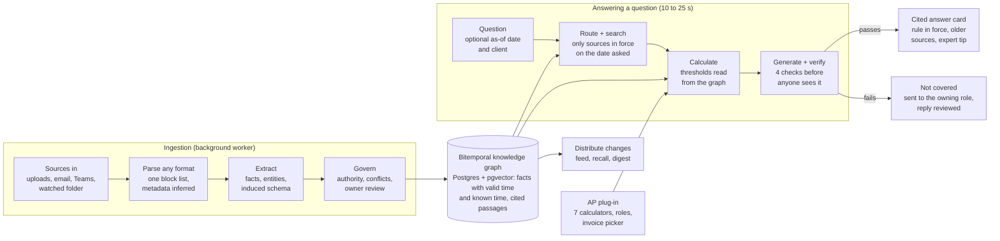

# PS-07 Knowledge Engine — What we built and why

15 Nov 2026 · Akshat · Study guide for the 16 Nov auction and 18 Nov final

The step-by-step demo for 16 Nov is in [DEMO_SCRIPT.md](DEMO_SCRIPT.md). Status and next actions live in [PROGRESS.md](../PROGRESS.md).

## 1. The problem and what we built

We built a generic knowledge engine that keeps one dated record of every rule a company has, and answers questions with cited, verified answers in 10–25 seconds. It scores **158/160 (98.8%)** on the PS-07 evaluation set, with **0/23** conflict questions answered with an outdated rule.

**The problem (PS-07).** Rules live in SOPs, spreadsheets, client memos, FAQs, emails and training recordings. Old versions stay in circulation, a stale FAQ contradicts the current SOP, and people answer each other from memory over chat. Our test company is **Meridian Shared Services**, a synthetic accounts-payable (AP) team. Its corpus has two SOP versions (v3.1 from 2023, v4.0 from 2026), desk instructions, client memos, an outdated FAQ, training transcripts and expert interviews.

**The requirement that shaped everything.** From the discovery call: any company must be able to drop its data in and use it, without anyone writing code or configuration for its domain first. So the engine is generic, and Meridian AP is only the first tenant and the evaluation dataset.

**What the engine does, in one line each:**

|  |  |
| --- | --- |
| Input | Any mix of documents and messages, dropped in once and added to over time |
| Core | A bitemporal knowledge graph: every fact records when it was true and when the engine learned it, and links to its exact source passage |
| Output | Cited answers, "what was true on date X", conflicts between sources, a review queue for the process owner, and notices when a rule someone relied on changes |
| Promise | Drop data in, answerable within minutes, stays correct as new data arrives |

**Success targets from the brief:** accuracy ≥ 95%, citations ≥ 90%, outdated answers < 2%, answer time < 30 s, abstention ≥ 90%. Gates: **A** MVP on 12 Nov, **B** internal auction on 16 Nov, **C** final on 18 Nov.

## 2. Architecture on one page

Everything flows through one dated graph in Postgres: documents go in through a background pipeline, and every answer is read from the graph and checked before anyone sees it.

The core (`app/`) is domain-agnostic and never imports the plug-in; the AP plug-in only adds calculators, roles and loaders. The stack: FastAPI and a Postgres job queue on the back end, Postgres 16 with pgvector for facts and search, local BGE embeddings and reranker, one LLM gateway (`app/core/llm.py`) for every model call, and a Next.js web app that talks to the API over HTTP only.

### 2.1 How documents get in

Every file, whatever its format, becomes one canonical list of blocks before anything else touches it, so nothing downstream depends on layout, numbering style or file type (CLAUDE.md rule 10).

**Ways in (connectors, `app/ingest/connectors/`):** upload on the Sources page (files, folders, zips), a watched folder, email files (`.eml`, attachments included) and Microsoft Teams chat exports (`.json`). Each arrival is an **episode**: stored unchanged, deduplicated by SHA-256 content hash, never deleted.

**The parser cascade (`app/ingest/parsers/`):**

| Tier | Handles | Status |
| --- | --- | --- |
| 1 | Native parsers: DOCX, XLSX/CSV, PPTX, PDF text layer (including "a \| b" text tables), HTML, Markdown and plain text, EML, VTT/SRT transcripts, JSON | Working |
| 2 | Legacy formats (DOC, PPT, XLS, ODF, RTF) converted by LibreOffice, then tier 1 | Working where LibreOffice is installed (not in the Railway image) |
| 3 | Scanned PDFs and images: pages rendered and read by a vision model | Working when `MODEL_VISION` is set |
| 4 | Audio and video speech-to-text | Not built |
| 5 | Anything unparseable: stored and flagged for a person | Working |

**From blocks to passages.** Blocks are typed (heading, paragraph, table row, speaker turn). Structure is inferred from evidence: heading styles, numbering, font size, speaker labels. Each **passage** is a structure-aware chunk (a section, a table, a transcript turn, an email body) with a **locator** used in citations: "AP SOP v4.0 §4.2", "DI-07 Part B, step 3", "Expert interview 1 \[07:50\]", a page, a cell range or a slide number.

**Metadata is inferred, never typed in.** Document type, version, status, owner, client scope, effective date and what it supersedes are read, in order, from file properties, the filename, header tables and first-page text, footers, and finally an LLM classifier. Each value keeps its source and a confidence; low confidence shows on the Sources page for the owner to fix once. Measured: 78 of 84 values match the hand-made source index (92.9%).

**Date precedence** matters for the time logic: an explicit effective date in the text, then the document date in the header, then the email sent date, then the file's modified time, then the ingestion time. The winning source of every date is recorded.

**Quality gate.** Each parse gets a score (characters extracted vs expected, junk-character ratio, heading and table integrity, OCR confidence). A low score escalates the file to the next tier; still low, and its facts are held for review instead of published.

**Email and Teams triage.** Incoming messages are classified before extraction: a **question** is recorded but not answered again, **noise** (out-of-office, lunch plans, newsletters) is dropped, and a **rule claim** or **tip** is extracted and goes through governance. A spoofed bank-change email in the test set was held for review, not applied.

### 2.2 How the graph stores facts

The "graph" is ordinary Postgres tables in which every fact carries two time ranges and a link to its exact passage; a fact is never edited or deleted, only closed off, which is what makes "what did we know then?" answerable.

**Four layers** (following the Zep / Graphiti paper):

| Layer | What it is | Example |
| --- | --- | --- |
| Episode | One raw input, stored as received | `PS-07_AP_SOP_v4.0_2026.docx`, an `.eml`, a Teams thread |
| Passage | A cited chunk of an episode, with its locator | AP SOP v4.0 §4.2 "Price tolerance" |
| Entity | A thing the facts are about; types are induced from the data | Arvana Infra (aliases "Infra BU", "AIL"), a supplier, the price tolerance |
| Fact | subject → attribute → typed value, with a scope and four timestamps | price tolerance → percentage → 1%, scope all clients, valid from 1 Apr 2026 |

**The four timestamps:**

- **Valid time** `valid_from` / `valid_to`: when the rule applied in the business. Drives "as of" questions.
- **Transaction time** `recorded_at` / `retracted_at`: when the engine learned it and when it stopped believing it. Drives "known at" questions and replay.
- Stored as `timestamptz` pairs with GiST range indexes; reads use `tstzrange @>` so they stay fast. A day is stored as midnight UTC, and "last day in force" *d* is stored as `valid_to = d + 1`.

**Retire, never delete (rule 6).** When belief changes, the live row gets `retracted_at` and a new version is inserted with the same `origin_key`. Old rows stay, so the engine can answer as it would have on any past day. Publishing a change (retire old, add new, bump `kb_version`, record the change) is **one transaction** (rule 7).

**Schema induction (`app/graph/induce.py`, `evolve.py`).** On a company's first upload the engine samples the corpus and proposes an ontology: entity types, topics and parameters with synonyms, document types, a draft authority ranking and a list of high-risk topics. The owner edits it on the Setup page and freezes it as schema v1. Topics found later are proposed through the review queue. The hand-written AP schema exists only as a comparison baseline and a safety net (`SCHEMA_MODE=baseline`).

**Fact extraction (`app/graph/extract.py`).** The extractor reads a passage plus its heading context; the frozen schema tells it what to look for. It never sees the file format. Every extraction result is cached on disk by a hash of the prompt version and input text (rule 8), so re-running ingestion gives the same graph.

**Entity resolution (`app/graph/entities.py`).** Candidate search by trigram and embedding similarity, then a model confirms the match (the Graphiti approach). The owner can merge entities on the Setup page. A new fact is compared only with related facts, same subject and attribute or nearest neighbours, never the whole graph (rule 12).

**Client-specific versions.** A client memo's rule is stored as a client-scoped version of the general attribute (the "Infra fix", 10 Nov), so a rule lookup for Arvana Infra finds the memo's 5% while every other client gets the SOP's 0%.

### 2.3 How authority and conflicts are settled, and what governance holds back

When sources disagree, the most authoritative current source wins, not the newest; and no rule change from outside the owner's scope goes live without the process owner's approval.

**Authority ranking (`app/graph/resolve.py`, `write.py`).**

1. Every source has a rank from its document type, version, status and client scope. The engine proposes the ranking during schema induction; the owner confirms it.
2. Statements about the same subject, attribute and client scope are compared as one group. Among sources with status *current*, the **lowest rank number wins**; a tie goes to the later start date. A newer statement from a lower-ranked source loses (CLAUDE.md rule 9).
3. A client memo is scoped to its client, so it wins only for that client. Everyone else keeps the SOP rule.
4. **An owner's email ranks with their memo.** An email scoped to one client and sent by that client's registered owner carries the memo's authority, so the later-starting change wins the tie. This is how the Infra owner's "7% from 16 Nov" email can amend memo CM-INF-02.
5. A statement that defers to another source ("as per the SOP") never beats it, and a longer list that contains a shorter one is one list, not a conflict.
6. **Practice never overrides a rule.** Expert habits, shadowing notes and supplier notes are stored as practice and shown as advice beside the rule.

The loser is not deleted: it is closed with a reason ("CM-INF-02 Part C (rank 2) takes precedence"), which is what the card's **Older sources on this topic** shows.

**The conflict scan (`app/graph/conflicts.py`).** After every build, the scan finds statements that disagree and sorts them: *different values*, *contradicts itself*, *practice vs rule*. Each opens a review item instead of the engine silently picking one. On the known-conflicts list it found **15/15**, with the authoritative source right in 14/15.

**Governance (`app/govern/policy.py`).** Applies to anything that arrives after setup:

| Who sent it | Topic risk | Result |
| --- | --- | --- |
| The registered owner of that scope | Low or normal | **Provisional**: answerable at once, labelled provisional, queued for the owner to confirm |
| Anyone else | Any | **Pending**: not applied; answers ignore it until the owner approves |
| Anyone | A topic the frozen schema marks high-risk | **Pending** |

The sender-authority map and the risk tiers come from the frozen schema, so nothing in the code is company-specific. An expert's reply to an escalated question, a Teams tip and an expert-capture entry all enter as input and pass the same gate (rule 13); captured entries are always held, whatever the `GOVERNANCE` setting. The **Review queue** collects every decision: rule changes, conflicts, escalated questions, expert practice, low-confidence metadata, reported answers and schema proposals.

### 2.4 How an answer is produced

An answer takes 10–25 seconds and passes through six stages; the model writes the sentences, but every rule value comes from a direct lookup and every number from a calculator, and four checks run before anyone sees it (`app/answer/pipeline.py`).

1. **One snapshot.** The whole answer reads one consistent database snapshot (REPEATABLE READ), so a rule published mid-answer can't mix old and new rules in one card. The card records the `kb_version` it read.
2. **Route (fast model, `router.py`).** The question goes to one of:
   - **lookup**: a rule question;
   - **calculator:** *plugin.family*: a case needing arithmetic or dates (price, quantity, TDS, approvals, MSME, e-invoice, duplicate);
   - **practice**: about a habit or know-how;
   - **out\_of\_scope**: general knowledge, chit-chat, personal advice or personal data. These never reach generation.

   The router also reads a date written in words ("in March 2026, what was…") as the as-of date, but ignores invoice dates in the case. It names the role that owns the topic, never the asker's own.
3. **Search (in parallel with routing, `retrieve.py`).**
   - **Keyword:** Postgres full-text search (weighted `tsv` column, GIN index, `ts_rank_cd`).
   - **Meaning:** pgvector cosine over passages, facts and entities (local BGE-small embeddings).
   - **Only what was in force:** both searches see only sources that were live on the date asked and in the asker's client scope. This is where the time logic bites.
   - **Fusion and rerank:** reciprocal rank fusion (k = 60), then the local cross-encoder `bge-reranker-base` keeps the top 6. If the best rerank score is below −4.0, the evidence is too weak and the answer is "not covered".
   - **Graph context:** entities linked to the question plus one hop, and the facts on the kept passages. If a kept passage is an expert note but no rule on its topic was kept, the rules in force on that topic are added. If two or more steps of a procedure are kept, its missing steps are added.
4. **Rule values and calculators.** `get_rule` (`app/graph/rules.py`) reads the facts table by topic, parameter, client and date. It cannot return an expired rule, and raises `RuleNotFound` rather than guess. The AP plug-in's seven calculators take their inputs from the question (a calculator never runs on a figure the asker didn't give) and their thresholds from `get_rule`, and return the decision, exception code, next owner and every step of the working.
5. **Generate (`generate.py`).** Closed-book: the model sees only the evidence (up to 12 items, each tagged with whether it is in force) and the calculator result, and writes cited sentences. Practice is written as "In practice, …" after the rule.
6. **Verify (`verify.py`), four checks:**
   1. every cited passage was retrieved, and quoted words really occur in it;
   2. every number appears in a cited passage, the calculator output or the question;
   3. no value that is not in force on the date asked appears for the topics answered (deterministic, from the facts table);
   4. a fast-model check that each sentence is supported by its citations.

   A failure regenerates once with the problems listed. Still failing: processors get the not-covered card, never the draft.

**The answer card** holds the decision, the cited answer, the calculator's working, the exception code and next owner, **Older sources on this topic** (what was replaced, by what, from when), the expert tip with its author and date, and **Who to ask** with a send button. Every answer is logged with its citations, so recall can find it later.

### 2.5 After the answer: telling people, capturing experts, staying safe

The engine doesn't wait to be asked again: when a rule changes it tells the people affected. It also captures what experts know, and every model call passes one gateway that strips personal data first.

**Distribution (`app/distribute/`).**

- **Change feed** (Changes page): every published change, old → new value, from when, from which source, and how many people acknowledged it ("Got it", remembered per person).
- **Answer recall:** when a rule that an answer cited in the last 7 days is replaced, the asker gets one notice per change ("An answer you got has changed"). Recall matches on what the answer *cited*, so it works even when two publishes commit out of order, and it re-queues if a change landed while the answer was being written.
- **Live updates:** a server-sent events stream (`GET /stream`) refreshes the badge, the feed and the Sources page at once.
- **Daily digest:** one summary of the day's changes, as a card and plain text. It can go out by email (any SMTP server) or to a Teams channel (Workflows webhook, Adaptive Card), on demand or at a set time.
- **Drafted document edits:** when a new rule contradicts a document still in force, the engine drafts the edited passage as a word diff. A check without any model confirms the new value is in it and the old one is gone.

**Expert capture (`app/capture/`, Expert capture page).** An expert answers five questions: who or what, the habit, how to spot it, what to do, how they know. The "who" is matched to known entities (a supplier), and the entry is checked against the rules in force: *fits*, *may conflict* or *no rule*. It goes to a named reviewer as one practice note, always held. Once approved, it appears beside answers that name its subject and in the invoice composer's vendor tips. Tested end to end on 15 Nov (T10).

**Teams chat history (`app/ingest/connectors/teams.py`).** A Microsoft Graph export becomes one episode per thread (a chat is split at pauses over 4 hours); each message is a cited turn ("Teams thread \[10:05\]"). Old questions are recorded, never re-answered; greetings and out-of-office replies are dropped; tips and rule claims are held for the owner. A thread's document type is always "teams", so a chat claim can never outrank a document. Synthetic test: 38/38 threads routed as intended.

**The LLM gateway (`app/core/llm.py`, rule 3).** Every model call, text or vision, goes through one function that:

- **redacts** PAN, IFSC codes, bank account numbers, phone numbers and email addresses before sending;
- sets **temperature 0**;
- **caches** each result on disk, keyed by prompt version, model and input, so reruns are reproducible and free;
- **logs** every call (redacted) with tokens, cost and latency to `logs/llm_calls.jsonl`;
- applies retries and the provider's rate limits.

Providers are a setting: `nim` (any OpenAI-compatible endpoint, here Isoquant with zero data retention requested), `openai` or `anthropic`; a Claude model id always goes to Anthropic, which lets a Claude judge grade DeepSeek answers in the same run.

**Guard-rail tests.** `tests/test_no_leakage.py` fails if application code opens the evaluation workbook; `tests/test_core_is_generic.py` fails if `app/` names Meridian, Arvana, tax terms or rupee amounts, or imports the plug-ins. Every table carries `tenant_id`, and only `app/store/` touches the graph tables.

## 3. Step by step: how it was built

The build took nine days, 7–15 Nov, and its biggest turn came on day one: the first version was rebuilt as a generic engine (v2) after the discovery call. The table runs in build order so it reads as a story; the source for each row is the dated entry in `PROGRESS.md`.

| Date | Step | What it added, and why it mattered |
| --- | --- | --- |
| 7 Nov | Phase 0–1, first version | Scaffold, LLM gateway with PII redaction and a disk cache, leakage test. Ingestion used a hand-written Meridian "domain pack" |
| 7 Nov | **v2 rebuild: generic core** | The discovery call ruled out hand-written packs. Rebuilt on a generic bitemporal store (`app/store/`), a Postgres job queue and worker. AP-specific code moved to `plugins/ap/`; a test now fails if `app/` mentions Meridian or tax terms |
| 7 Nov | Universal ingestion | Connectors and a parser cascade: every format becomes one canonical block list, metadata inferred from the document |
| 7 Nov | Schema induction + fact graph | The engine proposes its own ontology from the corpus; facts get two time ranges and an authority rank |
| 7 Nov | LLM provider: NVIDIA NIM | Free NIM keys first; models picked by a probe on a real extraction (Nemotron Ultra smart, Nemotron Lightning fast) |
| 8 Nov | Answer pipeline + eval harness | Router, hybrid search, calculators, grounded generation, 4-check verifier; the 160-question harness built early and run often |
| 8 Nov | API, conflict scan v2, web app | FastAPI routes; every page wired to the API (Ask, Sources, Conflicts, Review, Entities, Changes, Setup) |
| 10 Nov | Client scopes, MVP gaps, Claude run | Client-specific rules (Infra memo), one-command launcher; a full eval on Claude: 153/160 |
| 11 Nov | Pre-deploy fixes + first deploy | Owner amendments, email triage, answer speed. Vercel web + Neon database + API on a laptop through a Cloudflare tunnel; T1–T11 pass on the public site |
| 11–13 Nov | Provider: Isoquant DeepSeek v4.1 | Faster and far cheaper than NIM: 157/160, p50 22 s, $0.06 for all 160 questions |
| 13 Nov | Replay, Entity timeline, habit notes, recall | Rebuild the history in order on the Sources page; per-entity timeline; supplier notes from data rows; answer recall when a cited rule changes |
| 14 Nov | Format matrix, digest, abstention, Teams questions | Same SOP in 8 formats; daily digest by email/Teams; 20/20 out-of-scope questions refused; 32 real processor questions |
| 14 Nov | Concurrency: one snapshot per answer | A change published mid-answer can't mix old and new rules in one card; first load test (CPU-bound, 8–10 answers a minute) |
| 14–15 Nov | OpenAI provider + GPT-5 eval (Akshat, PR #2) | Third provider; GPT-5 scored 95.6% by hand review. Team kept DeepSeek |
| 15 Nov | Independent judge | Claude Sonnet grades DeepSeek's answers: 158/160, both judges agree on all 68 judge-graded questions |
| 15 Nov | Expert capture (T10) + Teams export | Five-question capture held for review; Teams chat history ingested without re-answering old questions |
| 15 Nov | Railway deploy + concurrency limits (Akshat, PRs #3–#5) | API and worker on Railway; DB pool 15 → 40, 16 answers at once, Anthropic limits, a probe for the provider's real limits. Then the first Railway load test (32–35 s median), MODEL\_THREADS and poll retries, and the verifier accepting explicitly rejected old values |

### Problems we hit, and how each was fixed

Judges trust a team that can explain its failures. Each row below is a real problem from `PROGRESS.md`, in the order we met them, with the fix and what it taught us.

| When | Problem | Fix | Lesson |
| --- | --- | --- | --- |
| 7 Nov | The first build was tied to Meridian's layout (numbered headings, a hand-written domain pack) | Rebuilt as a generic core + AP plug-in, with a test that fails if the core names Meridian | The brief's "any company" requirement shapes the architecture, not just the data |
| 7 Nov | Free NVIDIA models: DeepSeek on NIM timed out; Nemotron Ultra took \~47 s per extraction | Picked models by probing a real extraction; later moved to Isoquant | Choose models by measuring on your own task |
| 10 Nov | Claude answered well (95.6%) but dropped colleagues' know-how (tacit questions 5/9), and 15% of answers came back unverified | Answer prompt v5 adds practice as "In practice, …" after the rule; support check v3 accepts conclusions that follow from the evidence. Unverified 13 → 0 on the affected set | A strict verifier needs calibrating, or it withholds correct answers |
| 10 Nov | The outdated-value check blocked a ₹1,000 excess because ₹1,000 was also the old cap | A value that appears in the question or calculator output is the case's own figure, not an old rule | Guard-rails need exceptions for the user's own numbers |
| 10 Nov | Parallel evaluation workers loaded the AP plug-in half-way and every later question failed | Plug-in loading under a lock; a broken module is never left loaded | Concurrency bugs appear first in your own test harness |
| 10 Nov | The Infra memo's 5% was stored under its own attribute, so the quantity calculator applied 0% to Infra cement | Client-specific versions of an attribute, editable on Setup | Schema induction needs a way to say "this is the same rule, for one client" |
| 11 Nov | The Infra owner's 7% email ranked below the memo it amended, so authority kept 5% | An email from a client's registered owner ranks with that client's memo | Authority must account for who sent something, not only its type |
| 11 Nov | NVIDIA's free endpoint throttled to minutes per call on deploy day | Moved to Isoquant DeepSeek v4.1: p50 22 s, $0.06 a run | Have a second provider ready; one gateway makes switching a setting |
| 11 Nov | A Cloudflare quick tunnel closes any request after \~100 s | Async answers: `POST /ask/jobs`, then the page polls | Never hold a web request open for a model call |
| 13 Nov | "As known at" questions were only partly time-aware: a question about the moment after SOP v3.1 came back "not covered" | Search, passage tags, the in-force split and calculators all read the facts at `known_at` | Bitemporal logic has to reach every read, not just the facts table |
| 14 Nov | A rule published while an answer was being written could mix old and new rules, and the asker might never be told | One snapshot per answer; recall re-queued after save; recall matched on what was cited. A publish lock was tried and removed (deadlock risk) | Correctness under concurrency is designed, not tested in |
| 14 Nov | Load test: 25 users waited \~3 minutes; the CPU (local reranker) was the limit | Documented; hosted reranker and more answer threads planned | Measure before you scale |
| 14–15 Nov | GPT-5 with full reasoning was slow; some answers outlived the database's idle-transaction timeout | Low reasoning effort on the answer path: p50 32.5 s → 15.5 s | Reasoning effort is a latency setting |
| 15 Nov | The outdated metric counted "the 2% tolerance does not apply" as stating 2% (Q062) | An explicitly rejected old value no longer counts; any other mention still does | Metrics need the same care as the product |
| 15 Nov | Live test: the 16th person at once queued; model calls throttled | DB pool 15 → 40, 16 answers at once, the provider-limit probe | The defaults of libraries and free tiers become your limits |
| 15 Nov | On Railway, answers took 32–35 s median with only 3–5 users, twice the laptop | MODEL\_THREADS sets the local models' CPU threads to the container's share; /health shows the CPU quota; polls survive proxy hiccups | A container's CPU count is not the host's; measure on the real host before demo day |
| 15 Nov | A correct answer that named an old value in order to reject it ("not 2%") could come back unverified | The verifier and the evaluation metric now share one list of rejection patterns; "Use 2%, not 1%" still fails | The product's checks and the metrics must agree on what counts as wrong |

## 4. Key decisions and why we made them

Every decision below trades something away; knowing the trade is what lets you defend it on stage. The last column is the one-line answer if a judge pushes back.

| Decision | Why | What we gave up | If asked |
| --- | --- | --- | --- |
| **Generic core + domain plug-in** | The brief: any company drops data in with no code for its domain. Everything Meridian-specific lives in `plugins/ap/`; a test fails if `app/` names Meridian, tax terms or rupee amounts | More work up front; calculators for a new domain are still hand-written | "A second, unrelated company (Kestrel Freight HR) answered 10/10 with no code changes" |
| **Bitemporal facts (two dates on every fact)** | Valid time answers "what was the rule on 1 March?"; transaction time answers "what would we have said on 10 Nov?". Facts are closed, never deleted, so history is auditable | Every query filters on two ranges; more complex storage | "Ask with the as-of picker set to 1 Mar 2026 and you get SOP v3.1, labelled as the rule then" |
| **Authority beats recency** | Zep/Graphiti lets the newest fact win. In a company, an FAQ uploaded today must not override the SOP in force, and a client memo overrides only for that client | Needs a source ranking (proposed by the engine, confirmed by the owner) | "The outdated FAQ is in the corpus; it never wins over SOP v4.0" |
| **Owner review before rules go live** | A rule change from anyone but the scope's owner, or on a high-risk topic, is held as pending. An expert's reply is input, not a rule | Changes are not instant | "A spoofed bank-change email was held for review, not applied" |
| **Schema induced from the documents** | No hand-written ontology for each company. The engine proposes topics and parameters; the owner edits and freezes it | Induction can miss things | "A hand-written baseline schema is kept as a safety net (`SCHEMA_MODE=baseline`)" |
| **Calculators for numbers, never the model** | LLMs get arithmetic wrong. Seven AP calculators read every threshold from the graph, and raise an error when a rule is missing instead of guessing | Each domain needs its calculators written | "No rule value is hard-coded; change the SOP and the calculator changes" |
| **Verify before showing** | Four checks: citations real, every number sourced, no out-of-force value, each sentence supported. A failure is regenerated once, then the user gets "not covered" | Slower answers; some correct answers withheld | "0/23 conflict questions answered with an outdated rule" |
| **Escalate, never answer from general knowledge** | An uncovered question goes to the owning role, and the expert's reply goes through review before it becomes knowledge | Fewer questions answered automatically | "20/20 out-of-scope questions refused; 18/20 routed to a sensible role" |
| **Postgres only, no graph database** | Zep's data model on Postgres + pgvector. The limit is LLM calls per document, not the database | No native multi-hop graph queries | "A graph DB pays off around 10M facts per tenant with multi-hop queries; rule lookups are one hop" |
| **Local embeddings and reranker (CPU)** | No per-call cost, works offline, data stays local | CPU-heavy: about 3 s per answer, and the load test was CPU-bound | "A hosted reranker is the next step for scale" |
| **Provider: DeepSeek v4.1 on Isoquant** | NIM (free) was slow: p50 36 s. Claude: 95.6%, but $2.67 a run on a $5 key. Isoquant: 98.8% at $0.06 a run, with zero data retention requested. GPT-5 was tried and dropped | Depends on a small provider with no published rate limits | "Every call goes through one gateway, so switching provider is a setting" |
| **Async answers (`/ask/jobs` + polling)** | Proxies such as Cloudflare close a request after about 100 s; polling means a slow model never times out the page | Pending answers live in one process's memory | "That's why we run exactly one API replica" |

## 5. Results and evidence

The engine clears every accuracy target in the brief; the gaps are in formats (pptx, xlsx, flat docx below target) and in load, not in answer quality. Every number below has a report in `reports/` (README "Results", last updated 15 Nov).

| What | Result | Target |
| --- | --- | --- |
| Accuracy, all 160 questions (DeepSeek v4.1 answers, Claude Sonnet judge) | **158/160 (98.8%)**: dev 96/96, holdout 62/64 | ≥ 95% |
| Citation accuracy | **99.4%** strict, 100% lenient | ≥ 90% |
| Conflict questions answered with an old rule | **0/23** | < 2% |
| "Must not say" value appears | 1/71 (Q032 names 194J for a different contract type) | — |
| Out-of-scope questions refused | **20/20**; 18/20 sent to a sensible role | ≥ 90% |
| Latency (full eval, 14 Nov) | median 12.4 s, p95 24 s | < 30 s |
| Cost on Isoquant | $0.06 for all 160 questions | — |
| Acceptance tests T1–T11 on the public site (11 Nov) | **all pass**, 11–25 s per answer | all pass |
| Expert capture T10 (15 Nov) | passes end to end in the running app | T10 |
| Second company, no code changes (Kestrel Freight HR) | **10/10** cited answers | 10/10 |
| Replay of document history | **22/22** checks, idempotent | — |
| Conflict scan | **15/15** known conflicts found; right source in 14/15 | — |
| Real processor questions from Teams | 32/32 hand-picked; 28/31 random; no wrong or outdated rule | — |
| Same SOP in other formats (fact F1 vs .docx) | md 1.00, html 1.00, pdf 0.94, eml 0.93, scanned pdf 0.90 pass; pptx 0.87, xlsx 0.86, flat docx 0.80 below | ≥ 0.90 (scanned ≥ 0.80) |
| Metadata inferred vs hand-made index | 78/84 (92.9%) | ≥ 90% |
| GPT-5 instead of DeepSeek (Akshat, 14 Nov) | 95.6% by hand review (88.0% by its own GPT-5 judge), $1.50 a run | — |
| Load (laptop 14 Nov; Railway 15 Nov) | Laptop: 80/80 answered, 8–10 answers a minute, CPU-bound. Railway, 3–5 users: median 32–35 s, p95 43–47 s, 1 timeout (before MODEL\_THREADS) | 20 users, p95 < 30 s |

**Gate status as of 15 Nov:**

- **Gate A (12 Nov): met.** Generic ingestion, replay, T1–T9 + T11 on the deployed URL, second company 10/10, text formats.
- **Gate B (16 Nov): mostly met.** Scanned PDF passes (0.90); Entity timeline page and distribution (recall, digest, change feed) work. **Open:** pptx is 0.87, just under 0.90. The watched folder is off on Railway (`WATCH_ENABLED=false`), so show ingestion by upload or turn it on.
- **Gate C (18 Nov): partly met.** Accuracy, citations, outdated, latency, abstention and T1–T11 are met. **Open:** usability tests (5 people, 8 tasks) and the business case (≥ 15 days proficiency gain, 75% fewer superseded-rule errors). Latency on Railway: 32–35 s median at 3–5 users, above the 30 s target; the 20-user test is to be rerun after setting MODEL\_THREADS.

### How the results are measured

Know these definitions cold: a judge who doubts a number will ask how it was measured. The harness is in `evaluation/`, and every run writes a report, a per-question CSV and the full answer cards to `reports/`.

**The evaluation set:** 160 questions from the case workbook, split 96 dev / 64 holdout (stratified, seed 7). We fix failures only on dev; holdout failures are not inspected (two exceptions, Q021 and Q062, examined with the team's agreement).

| Question type | Count | How it is graded |
| --- | --- | --- |
| Scenario (a case with numbers: tolerance, TDS, due date, approvals…) | 92 | **By code**, against the expected result: decision, exception code, amounts and dates. No model involved |
| Conflict (built around an old or contradicted rule) | 23 | LLM judge + the outdated check |
| Factual | 23 | LLM judge |
| Procedural | 13 | LLM judge |
| Tacit (needs an expert's know-how) | 9 | LLM judge |

**The judge.** A model compares the answer with the gold answer and returns correct, partial or wrong with a reason (`eval/judge/prompt.md`). The headline run uses **Claude Sonnet 5.5 to judge DeepSeek's answers**, so no model grades its own output. A DeepSeek judge gave the same 158/160, and the two agreed on all 68 judge-graded questions. Still open: calibration against 30 hand grades.

**Each metric:**

- **Accuracy:** correct answers / all questions; partial counts as wrong.
- **Citation strict:** the answer cites the gold file *and* the exact gold section ("§4.2" = "4.2"; "8.2 and 11" accepts either). **Lenient** also accepts the parent section or the step's part ("Part B" for "Part B, step 3"). The expert tip's citation counts too.
- **Outdated (conflict):** on the 23 conflict questions, does the *current-rule part* of the card (answer, decision, working, not the Older sources list) state the value that must not be said? A mention the answer explicitly rejects ("the 2% rule no longer applies") is not counted; any other mention is.
- **Must-not-say:** the same check on the 71 questions that have a forbidden value.
- **Latency:** wall-clock time per question, p50 and p95, with several questions in flight at once.
- **Cost:** tokens from the gateway's call log, priced per model; the judge's calls are counted separately.

**Other test sets:** abstention (20 out-of-scope questions), replay probes (22 checks of the graph as documents arrive in order), format invariance (the SOP in 8 formats, fact F1 against the .docx), second company (Kestrel Freight HR, 10 questions, no plug-in), intake (12 mixed incoming files), and the 32 real Teams questions judged by hand.

**Not run at scale:** the ablation comparing naive vector RAG (A), whole corpus in context (B) and corpus + authority layer (C) against the full system (D) is built (`evaluation/baselines.py`) but was only smoke-tested on one question on 8 Nov. If a judge asks "how much better than plain RAG?", say it honestly and point to the conflict questions as the clearest evidence.

## 6. Deployment and scaling

The demo runs on three managed services for about $5: Vercel for the website, Railway for the API and worker, Neon for the database. The laptop tunnel stays as the backup.

| Part | Where | Why there |
| --- | --- | --- |
| Web app (Next.js) | Vercel, ps07-knowledge-engine.vercel.app | Free; the site is built with the API address fixed in (`NEXT_PUBLIC_API_BASE_URL`), so a new address means a rebuild (`scripts/point_vercel.py`) |
| API + worker | Railway, one Docker service (Hobby plan, $5/month), live at enterprise-knowledge-engine-production.up.railway.app | Both need the uploaded originals on one disk; the trial's 1 GB memory is too small (the two local models need about 2.5–3 GB) |
| Database | Neon Postgres (free plan), pooled URL | Already holds the built knowledge graph (742 facts); same region as Railway (Singapore) |
| Models | Isoquant DeepSeek v4.1 | About $0.0004 per question |
| Backup | Laptop + Cloudflare quick tunnel (`run_public.ps1`) | Proven on 11 Nov; one command, rebuilds Vercel with the tunnel address |

**How the 15 Nov live test was fixed.** In live testing the 16th person at once queued, and model calls were throttled. The causes were in our code, not Neon:

1. **Database pool.** The engine used SQLAlchemy's default pool of 15 connections, and each answer holds up to 2 for its whole run. Now 40 per process (`DB_POOL_SIZE` 10 + `DB_MAX_OVERFLOW` 30), and `/health` shows `db_pool` usage so a pool limit is visible.
2. **Answer queue.** The API worked on 4 answers at a time; now 16 (`ASK_CONCURRENCY`).
3. **Model throttle.** `NIM_MAX_CONCURRENT` / `NIM_MAX_RPM` were NVIDIA free-tier values (4 / 35), so the whole server made 4 model calls at a time. Isoquant publishes no limits, so `scripts/probe_llm_limits.py` measures what the account accepts and suggests settings.
4. **Anthropic fallback.** Capped at 8 parallel calls with 6 retries, so a crowd doesn't turn rate limits into failed answers. `railway_env.py` sends only the active provider's key to Railway.

**First load test on Railway (15 Nov, `reports/load_20261115_railway.md`):** answers were slower than on the laptop and above the 30 s target.

| Users | Answered | Median | p95 | Waiting for a thread |
| --- | --- | --- | --- | --- |
| 3 | 3/3 | 34.8 s | 43.2 s | 1.4 s |
| 5 | 4/5 (1 connection timeout) | 31.9 s | 47.2 s | 1.0 s |

Waiting is about 1 s, so the pool and threads are not the limit; answering itself takes 31–33 s, about twice the laptop. The likely cause: the local models size their CPU threads from the host's CPU count, not the container's share. The owner's fix the same day: `MODEL_THREADS` (set it to the service's vCPUs; `/health` now shows the container's CPU quota), and the web app now survives up to 5 dropped polls from a busy proxy instead of failing the answer.

**Still to do before the demo, in order:**

1. Set `MODEL_THREADS` and the model limits (from `scripts/probe_llm_limits.py`) on Railway; redeploy.
2. Rerun the load test at 5 / 10 / 20 users, watching `/health` (`db_pool`, `cpu`). Target: 0 errors, p95 under 30 s.
3. Point Vercel at Railway with `scripts/point_vercel.py` (the token stays in the laptop's `.env`, never on Railway), then ask one question on the public site.
4. Run `scripts/warm_demo.py` so the demo questions are cached, and rehearse.

## 7. Known gaps and honest answers to likely questions

Say the gaps before a judge finds them: each one has a reason and a next step, which reads as control, not weakness.

**Known gaps**

- **Formats:** pptx (0.87), xlsx (0.86) and flat docx (0.80) are under the 0.90 F1 target, mostly on free-text values worded differently; their calculations still match 100%. Audio and video transcription is not built.
- **Load:** one API process answers about 8–10 questions a minute and the CPU (local reranker) is the limit. On Railway the first test gave 32–35 s median with 3–5 users, before the models' CPU threads were set (MODEL\_THREADS). Each answer also holds a database connection while the model thinks; the pool fix covers demo scale, and the real fix is planned for after 18 Nov.
- **Judge calibration:** the 30 hand grades in `eval/judge/hand_graded.csv` are not filled in. Mitigation: two different judges (DeepSeek and Claude) agree on all 68 judge-graded questions.
- **Not measured yet:** entity-resolution F1, induced vs hand-written schema, the 50-document freshness test, paraphrase and adversarial sets, and the naive-RAG ablation at scale (built, smoke-tested only).
- **Other:** a failed extraction still marks the episode published; Teams digest not tested on a real channel; no login (anyone with the URL can ask, upload and approve).

**Likely questions**

| Question | Answer |
| --- | --- |
| Is this just RAG? | No. Search finds passages, but rule values come from a dated facts table by direct lookup, numbers come from calculators, and four checks run before anything is shown |
| How do you stop the old rule being given? | Search only sees sources in force on the date asked, and a deterministic check blocks any superseded value. Result: 0/23 on conflict questions |
| Why not let the newest document win? | An FAQ uploaded today would override the SOP. Authority ranks by document type, version, status and client scope; recency only breaks ties |
| Did you tune it to the test questions? | The app never opens the evaluation workbook (a test enforces it); holdout failures aren't inspected; a second company scored 10/10 with no code changes |
| What if the documents don't cover it? | "Not covered" card, and the question goes to the owning role. The expert's reply reaches the asker, labelled as not yet knowledge, until the owner approves it |
| What does it cost? | About $0.0004 per question on DeepSeek; hosting about $5 for the demo period |
| Why not GPT or Claude? | Tried both: Claude 95.6% at $2.67 a run, GPT-5 95.6% by hand review and weaker live. DeepSeek on Isoquant scored 98.8% at $0.06 a run. One gateway, so it's a setting |
| Does it scale? | Postgres handles it; the limit is model calls and CPU. Next steps: hosted reranker, release DB connections during model calls, move pending answers out of process memory for several API replicas |
| Is data safe? | PAN, bank accounts, IFSC and phone numbers are redacted before any model call; Isoquant zero data retention requested; every call is logged (redacted) |

## 8. Who did what, and where to look

If a judge asks "show me where that happens", this table gives the file. Fill in teammates' names before presenting; only Akshat's and Arnav's parts are known here.

**Contributions**

- **Core team (repo owner):** the engine end to end (ingestion, graph, answering, governance, distribution, web app, evaluation), the Railway setup on `main`, the first Railway load test with the `MODEL_THREADS` fix, and the verifier's rejected-value patterns.
- **Arnav:** team lead; concurrency work (one snapshot per answer) and the Railway/Vercel deployment.
- **Akshat:** OpenAI provider and GPT-5 evaluation with a hand review (PR #2); setup fixes (editable install, Python cap, migrations on start, empty path settings); diagnosis of the live-test queue and the fixes in PRs #3–#5 (DB pool, answer queue, Anthropic limits, single-key `railway_env.py`, provider-limit probe); this study guide and demo script; the 15 Nov PROGRESS.md update.

**Where things are in the repo**

| To show | Look in |
| --- | --- |
| Bitemporal facts (`valid_on`, `known_at`) | `app/store/facts.py` |
| Rule lookup, no guessing | `app/graph/rules.py` (`get_rule`) |
| Authority and conflict scan | `app/graph/resolve.py`, `app/graph/conflicts.py` |
| Schema induction | `app/graph/induce.py`, `evolve.py` |
| Parser cascade and metadata | `app/ingest/` |
| Answer pipeline (router → search → calculators → generate → verify) | `app/answer/pipeline.py` |
| The four checks | `app/answer/verify.py` |
| AP calculators | `plugins/ap/calc/` |
| One LLM gateway, redaction, cache | `app/core/llm.py`, `app/core/redaction.py` |
| Governance (what is held) | `app/govern/` |
| Recall, digest, change feed | `app/distribute/` |
| Expert capture, Teams connector | `app/capture/`, `app/ingest/connectors/teams.py` |
| "Core is generic" and "no leakage" tests | `tests/test_core_is_generic.py`, `tests/test_no_leakage.py` |
| Every number quoted | `reports/` and README "Results" |
| Deploy steps | `deploy/RAILWAY.md` |
